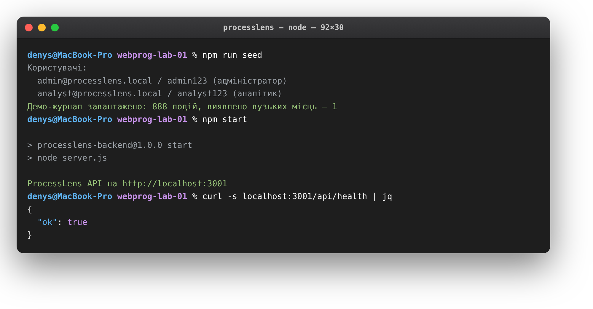
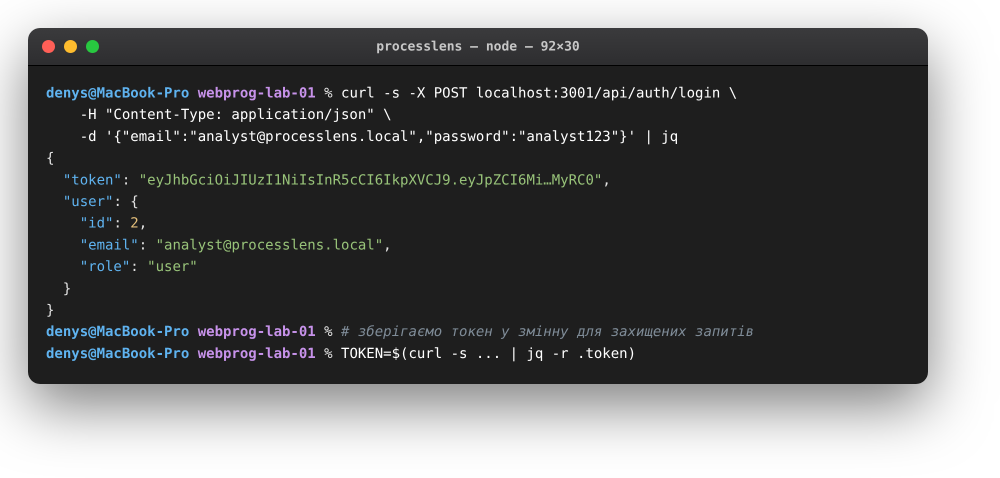
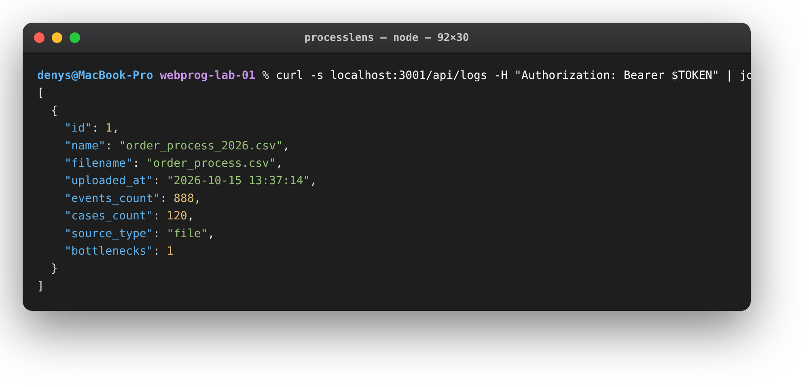
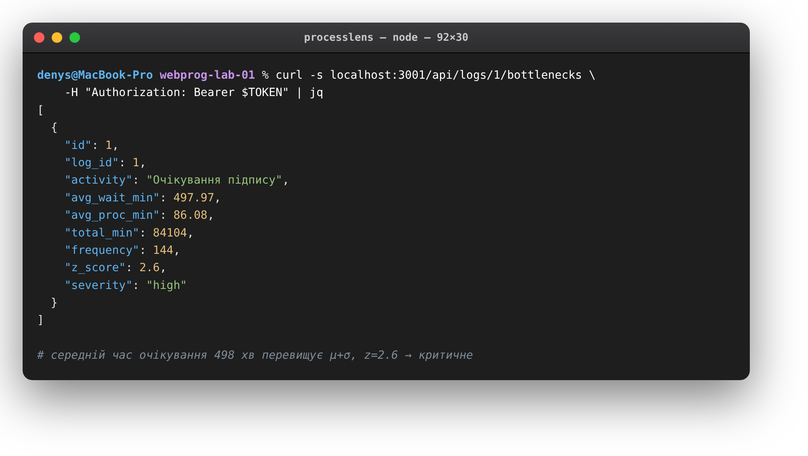
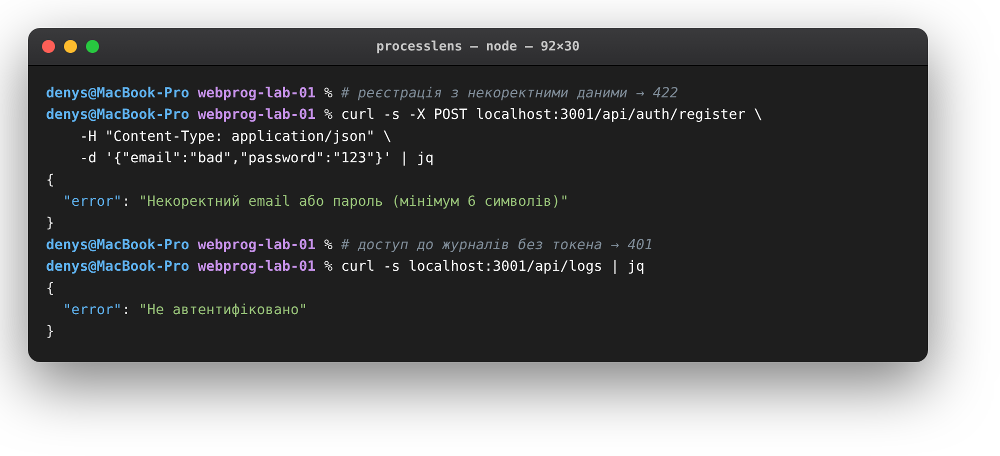

# ProcessLens · REST API

> Лабораторна робота №1 — **Вебпрограмування**
> Виконав: **Коваль Денис**

| | |
|---|---|
| **Застосунок** | ProcessLens — пошук «вузьких місць» у бізнес-процесах |
| **Частина** | серверна (REST API) |
| **Стек** | Node.js · Express · SQLite (better-sqlite3) |
| **Порт** | `3001`, префікс маршрутів `/api` |

---

## Що це

ProcessLens читає журнали операцій підприємства (хто, яку дію і коли виконував) і знаходить етапи, на яких замовлення найдовше «застоюються». Ця лабораторна присвячена серверній частині — REST API, що приймає журнали у форматі CSV, зберігає їх у базі даних, проганяє через аналітичне ядро й віддає клієнту результат у JSON.

Завдання роботи: спроєктувати модель даних предметної області, реалізувати маршрути REST для операцій над ресурсами, організувати зберігання в реляційній базі, перевірку вхідних даних і єдиний формат відповідей.

## Стек і запуск

Серверна частина написана на **Express 4** поверх вбудованої бази **SQLite** через синхронний драйвер `better-sqlite3`. Автентифікація — токени **JWT** (`jsonwebtoken`), паролі хешує `bcryptjs`. Завантаження файлів бере на себе `multer`, перевірку полів — `express-validator`, захист від перебору — `express-rate-limit`.

```bash
cd backend
npm install
npm run gen-sample   # демо-журнал order_process.csv
npm run seed         # демо-користувачі + демо-журнал
npm start            # http://localhost:3001
```

Після `seed` доступні два акаунти:

- **аналітик** — `analyst@processlens.local` / `analyst123`
- **адміністратор** — `admin@processlens.local` / `admin123`

## Структура коду

```
backend/
├── server.js       точка входу: Express, CORS, rate-limit, монтування маршрутів
├── config.js       JWT_SECRET, PORT, адреса конектора
├── db.js           підключення SQLite + схема таблиць і міграції
├── routes/         auth.js · logs.js · admin.js
├── middleware/     auth.js — requireAuth (JWT), requireAdmin (роль)
├── analysis.js     аналітичне ядро (статистика, граф, вузькі місця)
├── seed.js         демо-дані
└── gen_sample.js   генератор демо-журналу
```

## Дані

У базі чотири пов'язані таблиці зі зв'язками «один-до-багатьох» і каскадним видаленням:

- **users** — користувачі (`email` унікальний, `password_hash`, `role` = user/admin)
- **logs** — завантажені журнали (`user_id` → users, лічильники подій і кейсів)
- **events** — окремі події (`log_id` → logs; `case_id`, `activity`, `ts`, `resource`)
- **bottlenecks** — знайдені вузькі місця (`log_id` → logs; `avg_wait_min`, `z_score`, `severity`)

Видалення журналу каскадно прибирає його події та вузькі місця. Для швидких вибірок створено індекси за `(log_id, case_id, ts)` і `(log_id, activity)`.

## Як влаштовано API

**`/api/auth`**
- `POST /register` — реєстрація (email + пароль ≥ 6), повертає JWT
- `POST /login` — вхід, повертає JWT

**`/api/logs`** — усі маршрути потребують заголовка `Authorization: Bearer <token>`
- `GET /` — журнали поточного користувача
- `POST /` — завантаження CSV (поле `file`, multipart)
- `GET /:id` · `GET /:id/bottlenecks` · `GET /:id/graph` · `GET /:id/dashboard`
- `DELETE /:id` — видалити журнал
- `POST /connect` · `POST /:id/sync` — імпорт і синхронізація з живим джерелом

**`/api/admin`** — лише для ролі admin
- `GET /users` · `DELETE /users/:id`

Службовий `GET /api/health` → `{ "ok": true }`.

Успішні відповіді віддають дані прямо в JSON, помилки — у вигляді `{ "error": "…" }` зі статусами `401` / `403` / `404` / `409` / `422`.

## Захист і валідація

Поля входу та реєстрації перевіряє `express-validator` (формат email, довжина пароля). Паролі в базі — тільки bcrypt-хеш. Захищені маршрути проходять `requireAuth` (перевірка підпису JWT), адміністративні — додатково `requireAdmin`. Маршрути автентифікації обмежено за частотою, розмір завантаження — до 10 МБ.

## Виявлення вузьких місць

Для кожної активності рахується середній час очікування перед нею. Активність вважається вузьким місцем, якщо цей час перевищує **μ + σ** (середнє плюс стандартне відхилення по всіх активностях). Наскільки етап критичний — визначає z-оцінка: `high` при `z ≥ 2`, `medium` при `1 ≤ z < 2`. На демо-журналі ядро знаходить затор на етапі **«Очікування підпису»**: середнє очікування ≈ 498 хв, z ≈ 2.6, критичність `high`.

## Скриншоти

Запуск сервера і генерація демо-даних:



Вхід — відповідь із JWT-токеном:



Список журналів `GET /api/logs`:



Знайдене вузьке місце `GET /api/logs/1/bottlenecks`:



Помилки — валідація (422) і доступ без токена (401):



## Підсумок

Реалізовано серверну частину ProcessLens як REST API: описано модель даних із чотирьох таблиць, побудовано маршрути для автентифікації, роботи з журналами й адміністрування, налаштовано валідацію, автентифікацію за JWT та розмежування доступу за ролями. Аналітичне ядро винесено окремо — воно статистично знаходить вузькі місця у процесі. API повертає узгоджений JSON і коректно обробляє помилки, тож слугує надійною основою для клієнтської частини в наступних роботах.
